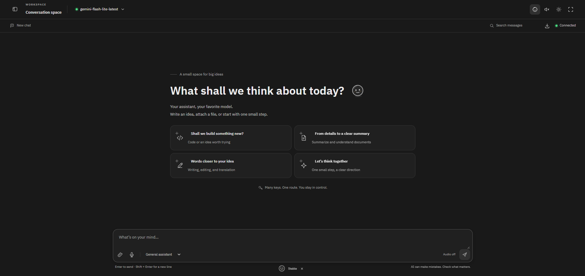
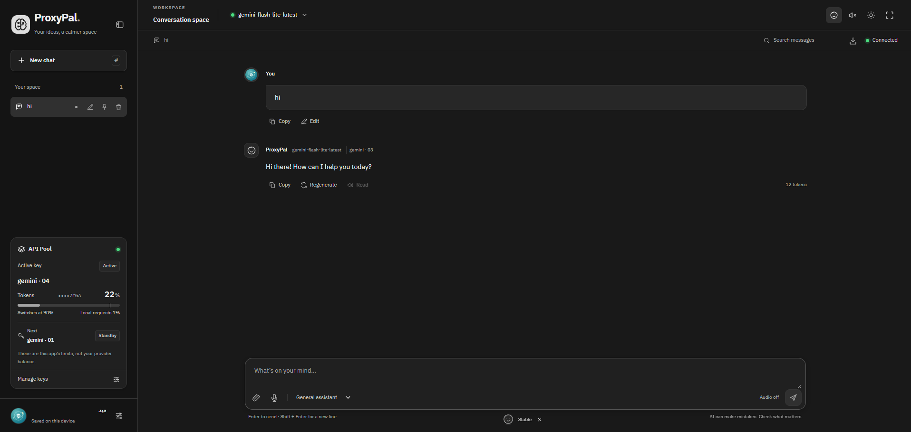
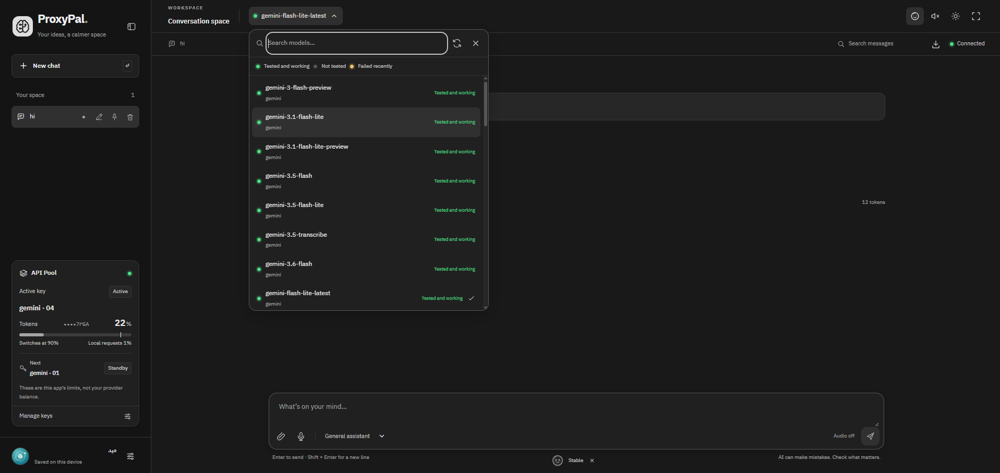
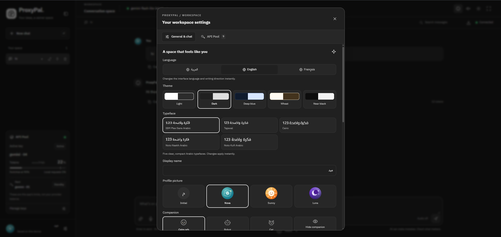
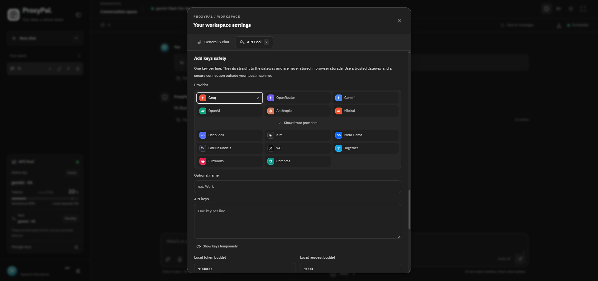
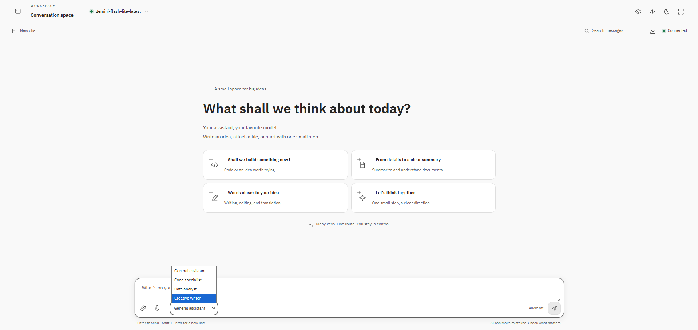
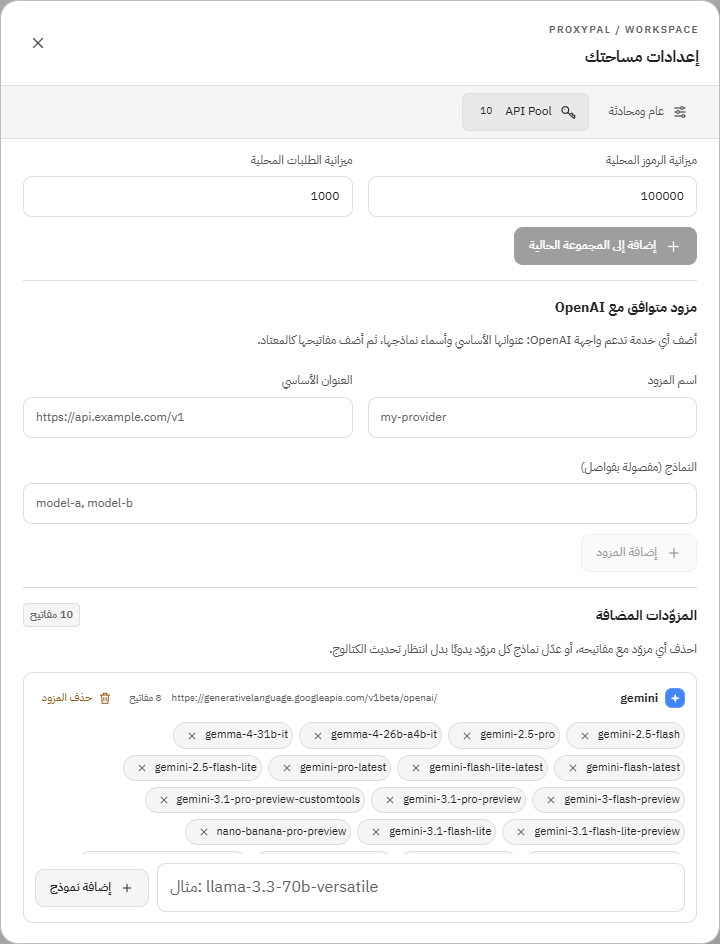

# ProxyPal — دردشة بلا حدود بمفاتيحك الخاصة

**ProxyPal AI v1.0.1** · بوابة ذكاء اصطناعي محلية تعمل بمفاتيحك أنت · local-first AI chat gateway

بوابة ذكاء اصطناعية محلية بواجهة عربية/إنجليزية/فرنسية. تدخل مفاتيحك مرة واحدة، ويوزّع
التطبيق الطلبات بين المفاتيح والمزودين تلقائياً: إذا نفد مفتاح أو تعطّل أو وصل إلى حدّه،
ينتقل إلى التالي دون أن تفقد المحادثة. المفاتيح تبقى على جهازك فقط.

<details>
<summary>English summary</summary>

**ProxyPal is a local-first AI chat gateway you self-host with your own provider API keys.**
You paste your keys once; the app rotates requests across keys and providers, cooling down an
exhausted, rate-limited or broken key and moving to the next one without losing the
conversation. It speaks the OpenAI wire format (`POST /v1/chat/completions`, streaming included),
ships preset catalogs for Groq, OpenRouter, Gemini, OpenAI, Anthropic, Mistral, DeepSeek, Kimi,
xAI and others, accepts any OpenAI-compatible endpoint as a custom provider, and runs entirely on
`127.0.0.1` — keys stay on your machine, masked in the UI and absent from logs. Trilingual UI
(Arabic/English/French), key budgets, model health checks, long-context trimming, conversation
management, TTS and an animated mascot included.

</details>

## المزايا

- دردشة streaming متوافقة مع OpenAI: `POST /v1/chat/completions`.
- مزودون جاهزون بشعاراتهم: Groq، OpenRouter، Gemini، OpenAI، Anthropic، Mistral،
  DeepSeek، Kimi، Meta Llama، GitHub Models، xAI وغيرها، مع زر «عرض كل المزودات»
  وإمكانية إضافة أي مزود متوافق مع OpenAI.
- مجموعة مفاتيح لكل مزود: توزيع `sticky` أو `round_robin` أو `least_used`.
- إدارة المزودات من الإعدادات: حذف أي مزود مضاف مع مفاتيحه، وحذف نموذج من قائمة المزود
  أو إضافة نموذج يدوياً، مع منع التعديل أثناء وجود رد جارٍ.
- حدود محلية اختيارية للرموز والطلبات لكل مفتاح (`never/daily/weekly/monthly`) مع تصفير تلقائي.
- موثوقية: مهلة تبريد تصاعدية بعد أخطاء 5xx، تجميد المفاتيح المرفوضة (401/403)
  أو المنتهية الرصيد (402)، وتخطّي النماذج غير المتاحة (404) دون إحراق بقية المفاتيح،
  واحترام `Retry-After` وحدود `x-ratelimit-*` الواردة من المزود.
- رسائل خطأ صريحة: «الرصيد منتهٍ» و«النموذج غير متاح» و«انتهت المهلة» بدل رسالة عامة،
  مع آخر خطأ لكل مفتاح في الإعدادات.
- فلترة نماذج الحماية والتصنيف والصور والصوت تلقائياً حتى لا تُعرض كنماذج دردشة.
- إدارة المحادثات: إعادة تسمية، تثبيت في الأعلى، حذف، والرجوع لآخر محادثة بعد إعادة التحميل.
- تحديث قائمة النماذج من المزود وفحصها معاً بالتوازي من زر Update، مع إخفاء النماذج
  التي يرفضها المزود نهائياً (400/404/422) والاحتفاظ بالنموذج المحدد ظاهراً.
- فحص صحة البوابة، وفحص النموذج المحدد تلقائياً في الخلفية.
- الكتابة لا تتجمد أثناء الرد: يبقى التركيز في حقل الرسالة، ويمكن متابعة الكتابة
  دون مسح المسودة، ويعود المؤشر إلى الحقل بعد انتهاء الرد أو إيقافه.
- شعار الدماغ الجديد، وشاشة تحميل ناعمة عند فتح التطبيق، وشاشة ترحيب لأول تشغيل
  تطلب الاسم الأول واختيار صورة شخصية من ثلاث، ثم ترسل رسالة `Hello "name" ^^`.
  الاسم والصورة قابلان للتغيير من الإعدادات.
- رفيق متحرك بتعبيرات مزاجية (استعداد، تفكير، تبديل، نعاس) بثلاثة أشكال،
  ومؤثرات صوتية قصيرة قابلة للإيقاف، وتصميم إعدادات مضغوط.
- سياق مجلد محلي اختياري داخل قسم قابل للطي، مع عرض جذر المجلد داخل البوابة
  ورسائل خطأ واضحة، وتجاهل الملفات الثنائية والسرية والكبيرة.
- وسوم واضحة على كل رد: «نموذج بديل» عندما يرد نموذج مختلف عن الذي اخترته لأن
  نموذجك غير متاح لدى المزود، و«تم التبديل» في تلميح اسم المفتاح فقط عند انتقال
  الطلب فعلياً إلى مفتاح آخر أثناء نفس الرد — أما التدوير الاعتيادي بين المفاتيح
  فيبقى هادئاً ولا يقطع الاحتفال في كل رسالة.
- إدارة السياق الطويل: تقليص الرسائل القديمة وتخفيض `max_tokens` بدل رفض الطلب،
  مع إبقاء المحادثة كاملة في الواجهة.
- إعدادات كاملة، تصدير المحادثات (JSON/Markdown)، إرفاق ملفات، قراءة صوتية،
  معاينة أكواد HTML داخل iframe معزول.

## لقطات

<p align="center">
  
</p>

| المحادثة والمفاتيح | اختيار النموذج وفحصه |
| --- | --- |
|  |  |

| إعدادات المساحة | إضافة المفاتيح والمزودات |
| --- | --- |
|  |  |

| المظهر الفاتح | حذف مزوّد وتعديل نماذجه |
| --- | --- |
|  |  |

## التشغيل المحلي (Windows)

```bat
run.bat
```

أو شغّل الخادمين منفصلين:

```bat
pip install -r requirements.txt
run-frontend.bat
run-backend.bat
```

بعد أي تحديث للكود، شغّل `restart.bat`. يوقف البوابة القديمة فقط إذا كانت تعمل بـ `gateway.py`
على المنفذ 8790، ثم يبدأ النسخة الجديدة ويتحقق من رقم إصدارها عبر `/health`.
إذا ظهرت في الواجهة رسالة «البوابة تعمل بنسخة قديمة»، فهذا يعني أن الخادم لم يُعد تشغيله بعد.

ثم افتح `http://localhost:5173`، اذهب إلى **الإعدادات ← مجموعة المفاتيح**، وأضف مفاتيحك.
التطبيق يفحص المفاتيح عند الإضافة ويرفض غير الصالح فقط.

يدوياً:

```bash
pip install -r requirements.txt
python gateway.py                      # http://127.0.0.1:8790
cd modern-workspace && npm install && npm run dev
```

## هيكل المستودع

```
gateway.py            بوابة FastAPI: التوجيه، التبديل، البث، نقاط إدارة المفاتيح والمزودات
api_pool.py           مجموعة المفاتيح: الهوية المقنّعة، التوزيع، الميزانيات، التهدئة، صحة النماذج
backend/tests/        اختبارات المحرّك (mock) واختبارات الواجهة (Playwright)
modern-workspace/     واجهة React 19 + Vite (بدون إطار CSS)
docs/                 خطة التطوير، الأخطاء والإصلاحات، شرح السكربتات، اللقطات
docs/screenshots/     لقطات الواجهة المعروضة أعلاه
data/                 يُنشأ فيه .gateway_token عند أول تشغيل (مستثنى من git)
workspace/            مجلد فارغ تُركّب داخله المشاريع لميزة «سياق مجلد محلي» (Docker)
run.bat restart.bat stop.bat setup.bat check.bat deploy.bat   سكربتات Windows
Dockerfile docker-compose.yml         تشغيل معزول على loopback
```

## كيف يعمل التبديل؟

1. الطلب يمر عبر مفاتيح المزودين المتاحين، مع تفضيل النموذج المطلوب ثم المفتاح النشط.
2. قبل الإرسال يُحجز مقدار تقريبي من ميزانية المفتاح؛ ومفاتيح الحدود الممتلئة تُتجاوز.
3. إذا فشل المزود قبل وصول أي نص، يُجرَّب المفتاح التالي بصمت.
4. إذا انقطع البث بعد وصول نص، يُحفظ الجزء الظاهر ويُعلَّم «غير مكتمل» ولا يُعاد إرساله.
5. بعد نجاح الطلب يُسجَّل الاستهلاك الفعلي (أو تقديري إن لم يرسل المزود عدّاداً).

> الحدود في التطبيق محلية وليست رصيدك الحقيقي عند المزود. استخدم مفاتيحك ضمن ما يسمح به
> كل مزود، ولا تحاول تجاوز حدوده.

## الأمان

- البوابة تستمع على `127.0.0.1` فقط، ولا تُفتح على الشبكة.
- عند أول تشغيل يُولَّد رمز وصول عشوائي ويُحفظ في `data/.gateway_token`، ويُطلب في كل
  نداء API (`Authorization: Bearer <token>`) عدا `/health`. افتح `http://127.0.0.1:8790/`
  مرة واحدة فيمنح المتصفح الرمز ويحفظه محلياً، أو الصقه في الإعدادات ← «الوصول إلى البوابة».
- لا تُطبع المفاتيح في الواجهة أو السجلات؛ تُعرَّض مقنّعة (آخر 4 أحرف).
- ملف الإعداد وقاعدة البيانات (`gateway_config.json` و`gateway.db`) محصوران بحساب
  المستخدم على Linux/macOS (`chmod 600`)، ومستثنيان من git ومن نسخة Docker.
- `.env` و`data/` وملف الرمز مستثناة من git.
- ميزة «سياق مجلد محلي» ترسل محتوى الملفات إلى المزود الذي تختاره؛ شارك مجلدات آمنة فقط.
- الملفات الحساسة (مفاتيح SSH، شهادات، `.env`، `credentials*`، `*token*`، ملفات المفاتيح
  الخاصة…) تُستثنى من اللقطة، لكن هذا إجراء احتياطي لا ضمان مطلق.
- مجلد المنزل بالكامل، وجذر القرص، ومجلدات النظام مرفوضة كمساحة عمل.
- المزود المخصص: المفتاح يُرسل إلى عنوان `base URL` الذي تدخله؛ لذلك يُشترط `https://`
  للمزودين البعيدين (`http://` لمضيف محلي فقط)، وتُرفض عناوين link-local وcloud metadata
  (`169.254.0.0/16` و`fd00:ec2::254`) حتى لو جاءت عبر اسم نطاق.
- الكتابة إلى مجلد المشروع معطّلة ما لم تضبط `WORKSPACE_ROOT` صراحة.
- للتبليغ عن ثغرة اقرأ [SECURITY.md](SECURITY.md) — لا تفتح issue علنياً.

<details>
<summary>Security (English)</summary>

- The gateway listens on `127.0.0.1` only.
- A random access token is generated on first start and stored in `data/.gateway_token`.
  Every API call needs `Authorization: Bearer <token>` except `/health`. Opening
  `http://127.0.0.1:8790/` once hands the token to the browser, which keeps it in
  localStorage; it can also be pasted under Settings → Gateway access.
- Keys are masked (last 4 characters) and never logged.
- `gateway_config.json` and `gateway.db` are restricted to the user account on Linux/macOS
  (`chmod 600`) and excluded from git and the Docker build.
- The workspace feature sends file contents to the chosen provider, so only share folders
  that are safe to send.
- Sensitive files (SSH keys, certificates, `.env`, `credentials*`, `*token*`, private key
  contents…) are excluded from snapshots, but that is a safety net, not a guarantee.
- The user's home directory, drive/filesystem roots and system directories are refused.
- Custom providers: the key is sent to whatever base URL you enter. Remote providers must
  use `https://` (`http://` is allowed for localhost only), and link-local or cloud-metadata
  addresses (`169.254.0.0/16`, `fd00:ec2::254`) are rejected even when reached through DNS.
- Workspace writes are disabled unless `WORKSPACE_ROOT` is set explicitly.
- Report vulnerabilities per [SECURITY.md](SECURITY.md), not in a public issue.

</details>

## Docker

```bash
docker compose up --build
# التطبيق: http://127.0.0.1:8790/app/
```

- المنفذ مربوط بـ loopback فقط، والملفان `gateway_config.json` و`gateway.db` يُستخدمان
  من مجلد المشروع مباشرة، فلا تفقد مفاتيحك عند إعادة بناء الحاوية.
- مجلد `data/` يُركّب على `/app/data`، فيبقى رمز الوصول `data/.gateway_token` صالحاً بعد
  إعادة إنشاء الحاوية. افتح `http://127.0.0.1:8790/` مرة واحدة ليمنح المتصفح الرمز.
- الحاوية تعمل بمستخدم غير جذري (`uid 10001`). على Linux، إن لم تستطع الكتابة في الملفات
  المركّبة، امنحها الملكية: `sudo chown -R 10001:10001 gateway_config.json gateway.db data`.
- مجلد `workspace/` (إن وُجد) يُعرض للقراءة فقط داخل `/workspace`. لاستخدام ميزة
  «سياق مجلد محلي» في Docker ضع مشروعك داخل `workspace/` واكتب مساره مثل
  `/workspace/my-app` (مسارات Windows الكاملة لا تعمل داخل الحاوية).
- قبل أول تشغيل تأكد من وجود الملفين: `gateway_config.json` و`gateway.db`
  (أنشئهما بتشغيل التطبيق محلياً مرة واحدة، أو على نسخة جديدة من المستودع):

  ```bash
  echo '[]' > gateway_config.json && touch gateway.db      # Linux/macOS/Git Bash
  ```

  ```bat
  echo [] > gateway_config.json & type nul > gateway.db    # Windows cmd
  ```

  بدون هذين الملفين يخلق Docker مجلدين بنفس الاسم مكان نقاط الربط ويتوقف التطبيق.

## المساهمة

اقرأ [CONTRIBUTING.md](CONTRIBUTING.md) قبل أول PR: ما الذي يعتبره المشروع ميزة،
أين تُضاف لغة أو مزود، وكيف تُشغّل الاختبارات. مستندو التصميم والملاحظات التراكمية في
[`docs/DEVELOPMENT_PLAN.md`](docs/DEVELOPMENT_PLAN.md) و[`docs/FIXES.md`](docs/FIXES.md)
و[`docs/SCRIPTS.md`](docs/SCRIPTS.md).

## الاختبارات

```bash
pip install -r requirements-dev.txt
python -m pytest backend/tests/test_api_pool.py -q
python backend/tests/test_proxypal_ui.py     # يحتاج Edge/Chromium عبر Playwright
cd modern-workspace && npm run lint && npm run build
```

اختبارات الواجهة تشغّل خادماً وهمياً (Mock) ولا تستهلك مفاتيح حقيقية، وتحتاج خادم
التطوير على `http://localhost:5173`. المجموع الحالي: 60 اختباراً للمحرّك و21 للواجهة
(يشمل اختبارات الرمز والصلاحيات وحدود مساحة العمل).
لتشغيل الاختبار الحقيقي على تطبيق Docker: `PROXYPAL_UI_URL=http://127.0.0.1:8790/app/`.

نماذج التفكير لدى Google تبثّ استدلالها داخل `content` مع علم `thought`؛ تمرره البوابة
كـ`reasoning` حتى يظهر تحت «تفاصيل الاستدلال» ولا يفسد نص الجواب.

`POST /models/refresh` يجلب كتالوج كل مزود ثم يفحص النماذج بالتوازي عبر كل المفاتيح
المتاحة. مفتاح يرفضه المزود بـ400 «Invalid Auth key» يُوقف وحده ولا يُحمّل فشله على
النماذج، وحد 429 في الفحص لا يضع المفتاح في تهدئة حتى لا تتعطل الدردشة.
كذلك يُعاد فتح أي نموذج أُخفي سابقاً بسبب 400 قبل إعادة فحصه.

## المتطلبات

Python 3.11+ وNode 20.19+ (أو 22.12+). إعدادات الاتصال في `.env` (انظر `.env.example`).

## الرخصة

MIT — انظر [LICENSE](LICENSE).
